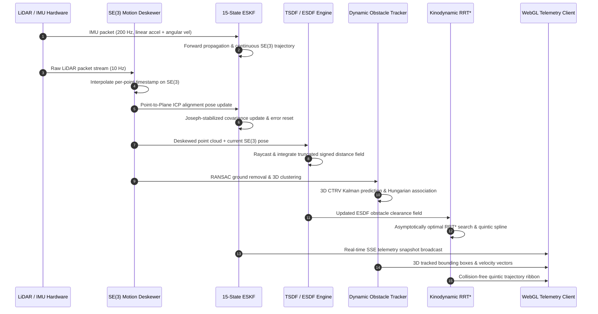

# Pelorus: System Architecture

Pelorus is designed as a modular, real-time spatial perception and kinodynamic planning engine written natively in Odin. It targets modern 64-bit architectures (ARM64 and x86-64) with zero garbage collection overhead, deterministic execution, and lock-free thread boundaries.

---

## 1. Top-Level Architectural Overview

```
                                +-------------------+
                                | LiDAR UDP Packets |
                                +---------+---------+
                                          |
                                          v
+------------------+            +-------------------+
| IMU Telemetry    |            | Packet Parser &   |
| (200 Hz Acc/Gyr) |            | De-skewing SE(3)  |
+--------+---------+            +---------+---------+
         |                                |
         v                                v
+------------------+            +-------------------+
| 15-State ESKF    |<-----------+ Downsampled Cloud |
| State Estimation |   Odometry | (Voxel Grid Cent) |
+--------+---------+            +---------+---------+
         |                                |
         | Continuous Pose                +------------------+
         v                                |                  |
+------------------+                      v                  v
| Volumetric TSDF  |            +------------------+ +------------------+
| Mapping Grid     |            | Ground Plane     | | Obstacle Cloud   |
+--------+---------+            | Segmentation     | | Extraction       |
         |                      +------------------+ +---------+--------+
         v                                                     |
+------------------+                                           v
| ESDF Wavefront   |                                 +------------------+
| Clearance Field  |                                 | Euclidean DBSCAN |
+--------+---------+                                 | 3D Clustering    |
         |                                           +---------+--------+
         | Clearance Gradients                                 |
         v                                                     v
+------------------+                                 +------------------+
| Kinodynamic RRT* |                                 | CTRV Multi-Target|
| Motion Planner   |                                 | Kalman Tracker   |
+--------+---------+                                 +---------+--------+
         |                                                     |
         v                                                     v
+------------------+                                 +------------------+
| Quintic Spline   |                                 | Tracked Dynamic  |
| Trajectory Gen   |                                 | Obstacle States  |
+--------+---------+                                 +---------+--------+
         |                                                     |
         +--------------------------+--------------------------+
                                    |
                                    v
                         +--------------------+
                         | Telemetry Engine   |
                         | (HTTP / SSE / WS)  |
                         +---------+----------+
                                   |
                                   v
                         +--------------------+
                         | WebGL 3D Dashboard |
                         | & Python SDK       |
                         +--------------------+
```

---

## 2. Execution Pipeline and Thread Scheduling

The perception engine coordinates asynchronous sensor input across deterministic execution stages:



---

## 3. High-Performance Memory Subsystems

### 3.1 Structure of Arrays (SoA) Point Representation

Standard Array-of-Structures (AoS) layouts suffer from severe cache pollution during coordinate-only algorithms (e.g. bounding box fitting, voxel hashing):

```
AoS Layout (Unfavorable for Vectorization):
[x0, y0, z0, i0, t0, r0] [x1, y1, z1, i1, t1, r1] ... (32 bytes per point)
```

Pelorus implements parallel `PointBufferSOA`:

```
SoA Layout (64-byte Cache Aligned):
X Coordinates: [x0, x1, x2, x3, x4, x5, ...] (Contiguous 32-bit floats)
Y Coordinates: [y0, y1, y2, y3, y4, y5, ...]
Z Coordinates: [z0, z1, z2, z3, z4, z5, ...]
Intensities:   [i0, i1, i2, i3, i4, i5, ...]
Timestamps:    [t0, t1, t2, t3, t4, t5, ...]
Ring Channels: [r0, r1, r2, r3, r4, r5, ...]
```

This layout allows ARM NEON and AVX2 vector units to load 4 or 8 coordinates per cycle with zero memory shuffle instructions.

### 3.2 Monotonic Bump Arena Allocators

High-frequency scan loops allocate and free temporary scratch structures (ray points, voxel keys, cluster candidates). To avoid OS heap fragmentation (`malloc`/`free` latency), Pelorus uses thread-local monotonic `Arena` allocators:
- Fixed backing buffer allocated once during startup.
- Allocations advance an offset pointer via pointer arithmetic with 8-byte alignment.
- Scopes reset the entire arena in $O(1)$ by restoring the offset watermark.

### 3.3 Lock-Free Single-Producer Single-Consumer (SPSC) Ring Buffers

IMU and LiDAR packets arrive asynchronously on high-priority I/O worker threads. Telemetry is passed to the state estimation engine through power-of-two circular ring buffers:
- Head and tail pointers stored on separate 64-byte cache lines to eliminate false sharing.
- Synchronization implemented with atomic acquire-release fences (`sync.atomic_load_explicit`, `sync.atomic_store_explicit`).
- Zero mutex contention during steady-state packet reception.

---

## 4. Hash-Indexed Sparse Volumetric TSDF & ESDF

The TSDF represents the continuous geometric surface of the environment within a sparse voxel grid.

### 4.1 Hierarchical Block Structure

Space is divided into discrete $8 \times 8 \times 8$ voxel blocks (512 voxels per block). At a voxel resolution of $5\,\text{cm}$, each block represents a $(40\,\text{cm})^3$ spatial cube.

### 4.2 64-bit Morton Z-Order Spatial Hashing

3D grid block indices $(x, y, z)$ are interleaved into 64-bit Morton codes via bitwise dilation:

```
x: ---- ---- ---- ---- ---- ---- ---- x2 x1 x0
y: ---- ---- ---- ---- ---- ---- ---- y2 y1 y0
z: ---- ---- ---- ---- ---- ---- ---- z2 z1 z0
Morton: ---- ---- ---- ---- ---- z2 y2 x2 z1 y1 x1 z0 y0 x0
```

Morton interleaving maps 3D spatial locality directly into 1D memory locality, ensuring neighboring spatial blocks share identical cache lines.

### 4.3 Robin Hood Open Addressing

Hash collisions are resolved using Robin Hood hashing with backward shift deletion:
- Each bucket stores block coordinate, block pointer, and probe sequence distance (PSL).
- If an inserting entry has a larger probe distance than the current occupant, the entries are swapped, and the displaced entry continues probing.
- Minimizes the variance of probe lengths, preventing long lookup clusters and guaranteeing $O(1)$ lookups even at 85% load factor.
